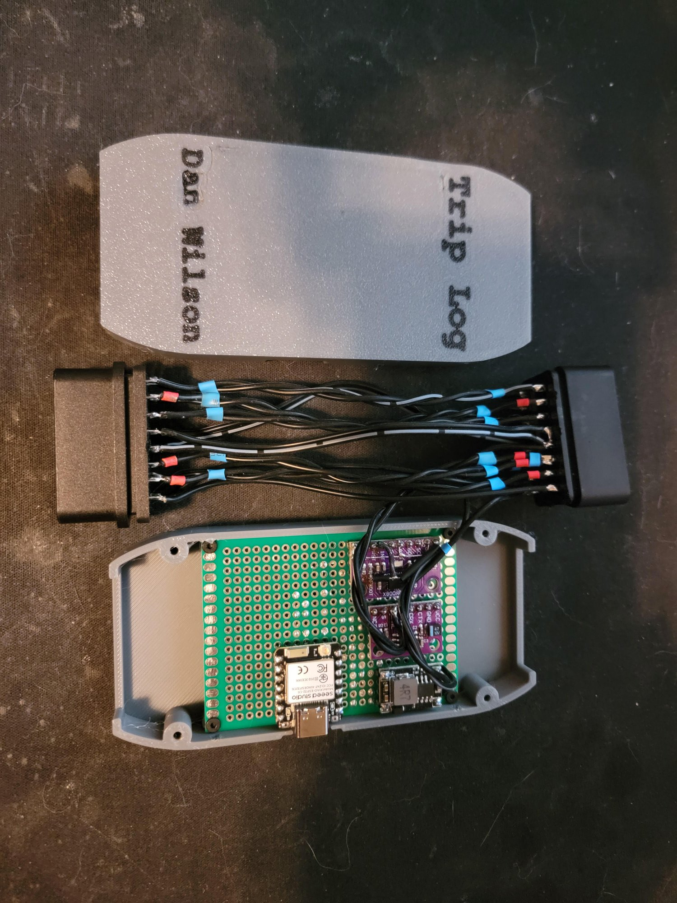

# XIAO ESP32-C6 CAN dongle: build spec

The OBD-II dongle that runs `embedded/can-dongle-firmware/esp32_can_ble_bridge` (1.8.0): CAN, IMU
and GPS over BLE to CANStream, the phone app (`canstream/`). This is the reference build; the second unit (built
2026-11-06) follows it. The phone does all recording; there is no SD card.

Status: **verified** = in the firmware or on a working unit; **planned** = not built yet;
**⚠ unverified** = not checked.

Second unit, 2026-11-06. On the board: XIAO C6 bottom centre, buck regulator to its right,
BNO08x and TJA1051 breakouts (purple) top right. The open left half of the board is the space for
the GPS, at the far end from the buck. The harness carries all 16 OBD pins, as twisted pairs, from
the plug to the rear socket.

## Parts

- Seeed XIAO ESP32-C6
- TJA1051 CAN transceiver breakout
- BNO085 9-DOF IMU breakout (`bno085_9dof_imu.md`). The second unit's is a purple board labelled BNO08X; whether the original's is the Adafruit board is ⚠ unverified
- u-blox MAX-M10S GPS breakout (`ublox_max_m10s.md`), on the bench unit only so far, with a u.FL
  antenna lead
- 5 V step-down (buck) regulator, input from OBD pin 16
- OBD-II pass-through shell (3D-printed housing on the second unit): all 16 pins carried through
  to a rear socket, so a scan tool or a second dongle plugs in behind it

## Wiring

| From | To | Status |
|---|---|---|
| OBD pin 16 (battery 12 V, live with ignition off) | buck regulator input | verified (both units) |
| OBD pin 5 (signal ground) | buck ground, common ground for all boards | verified |
| buck 5 V out | XIAO **5V** pin, TJA1051 **VCC**, BNO085 **VIN/VCC** | verified (both units) |
| OBD pin 6 (CAN-H) | TJA1051 CANH | verified |
| OBD pin 14 (CAN-L) | TJA1051 CANL | verified |
| XIAO D0 (GPIO0) | TJA1051 TXD | verified (firmware) |
| XIAO D1 (GPIO1) | TJA1051 RXD | verified (firmware) |
| XIAO D2 (GPIO2) | TJA1051 S | verified (firmware); see "S pin" |
| XIAO D4 (GPIO22) | BNO085 SDA | verified (firmware), I2C at 100 kHz |
| XIAO D5 (GPIO23) | BNO085 SCL | verified (firmware) |
| BNO085 address strap | high → address **0x4B** (the firmware's address; the Adafruit default is 0x4A) | verified (firmware); see "IMU address" |
| BNO085 INT, RST | not connected (the firmware polls) | verified (firmware) |
| XIAO D8 (GPIO19) | GPS TX (module → XIAO, UART1 RX) | verified (bench unit, 2026-11-17) |
| XIAO D9 (GPIO20) | GPS RX (XIAO → module, UART1 TX) | verified (bench unit) |
| XIAO D10 (GPIO18) | GPS TIMEPULSE (PPS), input only | verified (bench unit); see "GPS" |
| GPS VCC, GND | supply and common ground; which rail feeds the breakout | ⚠ unverified |
| XIAO GPIO15 | onboard LED, nothing to wire | verified |

Notes:
- **TJA1051 on 5 V.** It needs a 4.5–5.5 V supply (`tja1051_breakout.md`).
- **BNO085 from 5 V** works on both units, via the breakout's own regulator.
  Whether its I2C lines are level-shifted, or pulled up to 3.3 V, is ⚠ unverified.
- **RXD voltage into D1.** Without a VIO pin tied to 3.3 V, RXD swings to 5 V, which is above the
  ESP32-C6's rated input. It has worked on the original unit. Whether these breakouts have a VIO
  pin is ⚠ unverified; none is visible on the second unit's board in the photo (pins S, CTX, CRX, GND, VCC).
- **No 120 Ω termination** on the dongle; the car's bus is already terminated.
- **Battery drain.** Pin 16 is live with the ignition off, so a plugged-in dongle draws from the
  battery when the car is off.
- **USB while powered from the car.** Whether the XIAO isolates its 5V pin from USB VBUS is
  ⚠ unverified. Update over OTA; for USB flashing, unplug the dongle from the car first.
- **No hold-up capacitor.** The original unit had one to give the SD card time to finish
  writing after power loss. There is no SD card now, so it isn't needed.

## S pin (transceiver silent mode)

On a genuine TJA1051, S HIGH turns the transmitter off and S LOW is normal mode (NXP TJA1051
Rev. 9, 7.1). Since firmware 1.8.1, S is held LOW: listen mode is the TWAI controller's
LISTEN_ONLY alone, and the firmware never calls `twai_transmit`. Wire S to GND on new builds;
a D2 connection is harmless (1.8.1 drives it LOW) but buys nothing.

- **Original unit:** S tied to GND.
- **GPS bench unit (2026-11-17):** S was wired to D2. It received no CAN at all from a bench
  simulator that the original unit received fine: 0 frames and 0 bus errors, with the wiring
  and the CAN-H/CAN-L path checked chip to chip by the user. Holding S low through D2 (1.8.1,
  measured 0.5 V), then tying S straight to GND, changed nothing. RXD sat at 0 V with VCC
  at 5 V, TXD idle at 3.3 V, and RXD lifted off D1; a second module did the same. These
  modules (a newer batch) have the chip's pin 5 labelled VIO on the underside, with no
  header pin for it. On a TJA1051T/3, RXD's high level comes from VIO, so an unconnected
  VIO would hold RXD low. That is the leading explanation, not yet tested (⚠ unverified):
  VIO was bodged to the XIAO's 3V3 on 2026-11-17 and is not yet tested on a working bus.
  The modules are not shown to be dead.
- **Symptom to recognise:** RXD stuck low (dominant) gives `can 0` and `bus_errors 0` together. The
  controller never sees the 11 recessive bits it needs to join the bus, so it logs no errors.
  A wrong bitrate or swapped CAN-H/CAN-L gives bus errors instead.

## IMU address

The firmware looks for the BNO085 at **0x4B** only. On 2026-11-17 the bench unit (the one with the
GPS) logged `not found @0x4B (will retry)` on every boot: its address pin was strapped low, which
gives 0x4A. Rewiring it high, as on the other units, fixed it: after the rewire CANStream showed
IMU events arriving (about 250 when checked; verified 2026-11-17).
The firmware stays at 0x4B so every dongle is the same. Check this strap first if the IMU goes
missing.

## GPS

A u-blox MAX-M10S on UART1 (pins in the wiring table), working on the bench unit since firmware
1.8.0 (2026-11-17). Its own gotchas are in `ublox_max_m10s.md`.

- **Configured on every boot, RAM layer only:**
  - 115200 baud
  - GPS + Galileo (BeiDou and GLONASS off, which 10 Hz needs)
  - 100 ms rate
  - automotive dynamic model
  - NMEA off, UBX-NAV-PVT every epoch

  The config is redone after 3 s with no PVT, and every 30 s after 5 failed tries. It never blocks
  the CAN loop. USB serial `GPSCFG` re-runs it.
- **Output:** one `GPS,fix,sats,lat,lon,alt_m,speed_mps,heading_deg,hacc_m,utc_ms,pps_ts,ts` line
  per fix over BLE (format in the sketch header). CANStream puts fixes with a 2D or 3D fix into
  `TelemetryFrame.dongle_gps`, beside the phone's own `gps` section (`telemetry.proto`).
- **PPS:** D10 is a plain input. TIMEPULSE doubles as the module's SAFEBOOT_N, so pulling it low at
  power-up would boot the module into safeboot. Don't add a pull-down.
- **Bench, 2026-11-17 (verified):**
  - 10 fixes/s, 3D, 13–17 satellites, hAcc 0.4–0.8 m.
  - Configured 0.7–1.3 s after a warm boot, and 7.1 s after a cold power-up.
- **In CANStream (verified 2026-11-17):** Settings showed "Dongle GPS: 3D, 15 sats, ±0.3 m" live.
  Fixes reaching the cluster (`gps_source: dongle` on `telemetry.raw.gps`) are ⚠ unverified: no
  capture was running at the time.
- **Antenna:** a magnetic active roof antenna, powered from the breakout (3.3 V, the user's
  measurement). In the car it runs through a u.FL → SMA pigtail in the housing (planned).
  Placement:
  - Keep the module and the pigtail away from the buck regulator's inductor; switching noise can
    reduce GPS sensitivity (⚠ unverified on this board).
  - u.FL connectors survive only a few dozen matings, so fix the pigtail to the housing so cable
    pulls don't land on the connector.
