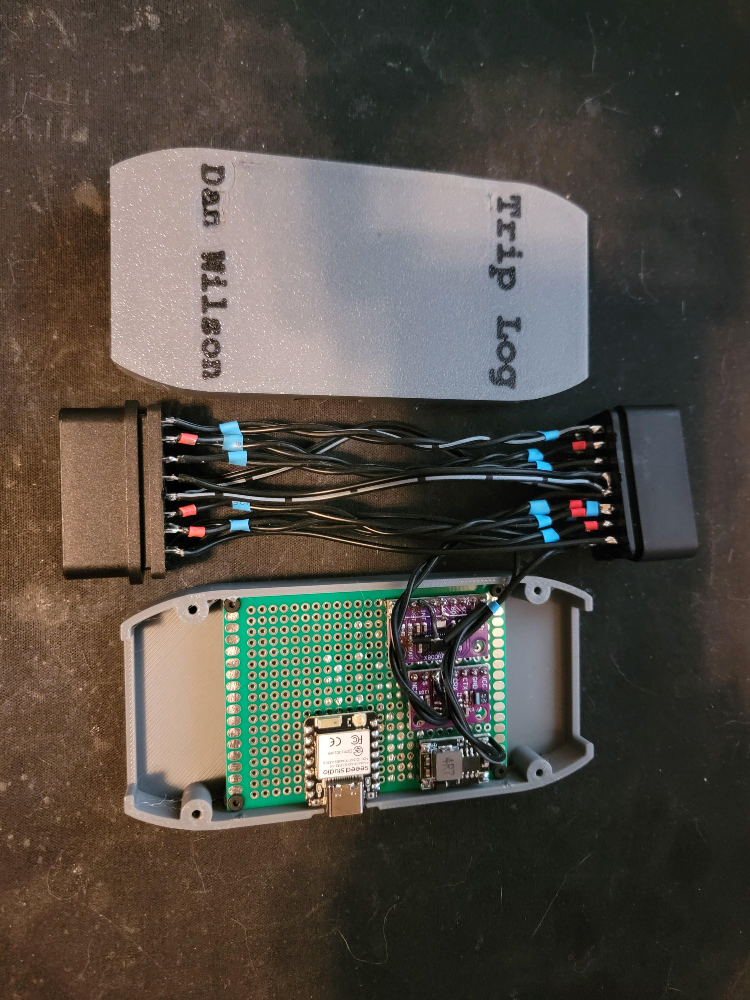

# XIAO ESP32-C6 CAN dongle: build spec

The OBD-II dongle that runs `embedded/dbc-forge/firmware/esp32_can_ble_bridge` (1.7.2): CAN and
IMU over BLE to the phone gateway. This is the reference build; the second unit (built
2026-11-06) follows it. The phone does all recording; there is no SD card.

Status: **verified** = in the firmware or on a working unit; **planned** = not built yet;
**⚠ unverified** = not checked.

Second unit, 2026-11-06. On the board: XIAO C6 bottom centre, buck regulator to its right,
BNO08x and TJA1051 breakouts (purple) top right. The open left half of the board is the space for
the GPS, at the far end from the buck. The harness carries all 16 OBD pins, as twisted pairs, from
the plug to the rear socket.

## Parts

- Seeed XIAO ESP32-C6
- TJA1051 CAN transceiver breakout
- BNO085 9-DOF IMU breakout (`bno085_9dof_imu.md`). The second unit's is a purple board labelled BNO08X; whether the original's is the Adafruit board is ⚠ unverified
- 5 V step-down (buck) regulator, input from OBD pin 16
- OBD-II pass-through shell (3D-printed housing on the second unit): all 16 pins carried through
  to a rear socket, so a scan tool or a second dongle plugs in behind it

## Wiring

| From | To | Status |
|---|---|---|
| OBD pin 16 (battery 12 V, live with ignition off) | buck regulator input | verified (both units) |
| OBD pin 5 (signal ground) | buck ground, common ground for all boards | verified |
| buck 5 V out | XIAO **5V** pin, TJA1051 **VCC**, BNO085 **VIN/VCC** | verified (both units) |
| OBD pin 6 (CAN-H) | TJA1051 CANH | verified |
| OBD pin 14 (CAN-L) | TJA1051 CANL | verified |
| XIAO D0 (GPIO0) | TJA1051 TXD | verified (firmware) |
| XIAO D1 (GPIO1) | TJA1051 RXD | verified (firmware) |
| XIAO D2 (GPIO2) | TJA1051 S | verified (firmware); see "S pin" |
| XIAO D4 (GPIO22) | BNO085 SDA | verified (firmware), I2C at 100 kHz |
| XIAO D5 (GPIO23) | BNO085 SCL | verified (firmware) |
| BNO085 address strap | high → address **0x4B** (the firmware's address; the Adafruit default is 0x4A) | verified (firmware) |
| BNO085 INT, RST | not connected (the firmware polls) | verified (firmware) |
| XIAO GPIO15 | onboard LED, nothing to wire | verified |

Notes:
- **TJA1051 on 5 V.** It needs a 4.5–5.5 V supply (`tja1051_breakout.md`).
- **BNO085 from 5 V** works on both units, via the breakout's own regulator.
  Whether its I2C lines are level-shifted, or pulled up to 3.3 V, is ⚠ unverified.
- **RXD voltage into D1.** Without a VIO pin tied to 3.3 V, RXD swings to 5 V, which is above the
  ESP32-C6's rated input. It has worked on the original unit. Whether these breakouts have a VIO
  pin is ⚠ unverified; none is visible on the second unit's board in the photo (pins S, CTX, CRX, GND, VCC).
- **No 120 Ω termination** on the dongle; the car's bus is already terminated.
- **Battery drain.** Pin 16 is live with the ignition off, so a plugged-in dongle draws from the
  battery when the car is off.
- **USB while powered from the car.** Whether the XIAO isolates its 5V pin from USB VBUS is
  ⚠ unverified. Update over OTA; for USB flashing, unplug the dongle from the car first.
- **No hold-up capacitor.** The original unit had one to give the SD card time to finish
  writing after power loss. There is no SD card now, so it isn't needed.

## S pin (transceiver silent mode)

S HIGH turns the transceiver's transmitter off; S LOW is normal mode (NXP TJA1051 Rev. 9, 7.1).
The firmware holds S HIGH at boot and in listen mode, and drives it LOW only in ack mode.

- **Second unit and later:** S wired to D2. Listen mode is then passive twice over: the CAN
  controller in listen-only mode, and the transmitter off.
- **Original unit:** S is tied to ground, not wired to D2, so the transceiver is always in normal
  mode. Listen mode relies on the controller's listen-only mode alone; ack mode works.
  Don't copy this: S on D2 also keeps the transmitter off through boot, OTA and any firmware
  fault.

## GPS (planned)

A u-blox M10 module, space left on the second unit's board. Its antenna lead runs u.FL → SMA
pigtail to a magnetic roof antenna.

- No firmware support yet. The GPS UART pins are not chosen yet (planned).
- Module supply voltage: check the module (⚠ unverified).
- The magnetic antenna is active, so the module must supply antenna power up the coax.
- Keep the module and the pigtail away from the buck regulator's inductor; switching noise can
  reduce GPS sensitivity.
- u.FL connectors survive only a few dozen matings: fix the pigtail to the housing so cable pulls
  don't land on the connector.
